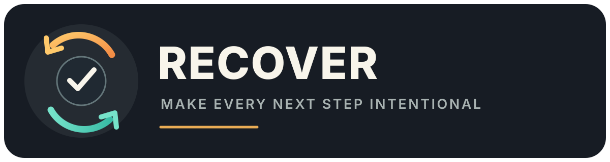

# RECOVER — Human-Approved Revenue Recovery

<p align="center">
  
</p>

A revenue-recovery workflow prototype that helps businesses find earned revenue that has not yet been collected. It connects business and payment records, ranks follow-up opportunities, and prepares approval-gated outreach for a human to review.

## What is included

- A tenant-aware API, React dashboard, and background worker.
- Detection rules for incomplete payments and recoverable business events.
- Shared adapters for CRM, commerce, accounting, email, telephony, and payment providers.
- Approval and audit records for outbound actions.
- OAuth credential encryption and webhook verification paths.

External providers require credentials configured by the operator. The repository contains no production credentials, and integrations should be tested with provider sandboxes first.

## Run locally

Requirements: Node.js 24, npm 11, Docker Compose, and PostgreSQL. The development Compose profile starts local PostgreSQL, Redis, and MailHog services.

```sh
cp .env.example .env
npm ci
docker compose --profile dev up -d postgres redis mailhog
npm run db:generate
npm run db:migrate
npm run db:seed
npm run dev
```

Use fictional development data only. Keep `.env`, OAuth tokens, payment credentials, customer exports, and production logs out of Git.

Useful commands include `npm run build`, `npm run lint`, `npm test`, and `npm run test:smoke`. See [RUNBOOK.md](RUNBOOK.md) for deployment guidance and [IMAGE_ASSET_PLAN.md](IMAGE_ASSET_PLAN.md) for the current asset inventory.

## Project status

This is an actively developed product prototype. Provider coverage, workflows, and compliance requirements need review for each deployment. The application does not replace legal, accounting, or payment-provider advice.

See [CONTRIBUTING.md](CONTRIBUTING.md) for development guidance and [SECURITY.md](SECURITY.md) for vulnerability reporting.

## License

This source-available project is licensed under the [PolyForm Noncommercial License 1.0.0](LICENSE). Noncommercial use is permitted under its terms; commercial use requires separate written permission.

## Contact

Stephane Jacob <jacobstephane@outlook.com>
